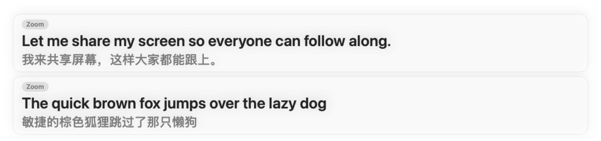

# EchoCap

**Mac 上播放什么，就配上实时字幕。** 菜单栏常驻，浮层置顶，音频不出这台 Mac。

[English](README.en.md) · 简体中文



---

## 这是什么

对标 [subtitles-live.com](https://subtitles-live.com/zh/) 的同名产品：**捕获 Mac 正在播放的任何声音**（会议、播客、视频、网课、直播），在本机完成语音识别，实时画在一层始终置顶的浮层上，可选翻译成另一种语言并双语显示。

与原产品不同的是，EchoCap 不下载任何模型 —— 它直接用 macOS 26 自带的 Speech 与 Translation 框架，装好即用，全程离线。

| | 原产品 Subtitles | EchoCap |
|---|---|---|
| 语音识别 | Parakeet / Nemotron（Core ML，633 MB 模型） | **macOS Speech 框架**（系统自带，无需下载） |
| 翻译 | Apple Translation（设备端） | **Apple Translation**（设备端，同源） |
| 系统音频捕获 | Core Audio process tap | **Core Audio process tap**（同一套 API） |
| 支持语言 | 18 种 + 2 种实验 | 系统已装模型的语言（本机实测中英文等 11 种已装） |
| 识别延迟 | 160 ms – 2.08 s（按模型档位） | 由系统模型决定，本机实测流式出字 |
| 价格 | $19 买断 | 开源免费 |

## 已实现的功能

**声音来源**
- 捕获系统正在播放的一切（任何 App，包括浏览器与 Electron 应用）
- 麦克风输入
- 切换来源时清空字幕并重置识别器

**字幕**
- 置顶浮层，始终在所有窗口之上
- **不吃点击**，可以隔着它继续在下面的 App 里工作
- 按住 `⇧` 拖动浮层，位置会被记住
- `⌥⌘L` 或菜单「调整浮层位置与大小」进入调整模式：窗口会收下鼠标，可以**任意拖动**、拖四边或四角**改大小**（最小 360×96），带虚线提示；退出后恢复点击穿透
- 原文行数、译文行数**各自可调**（默认各 2 行）：写满后最早的内容滚出，不是把整块清空
- 译文行数默认 2 行，字号略小，放在原文下面当阅读辅助
- 无新文字约 4 秒后淡出（按"最后一次出现新文字"算，不是按音频静默算）

**选哪个模型**
- **语音识别永远在本机**：用的是 macOS 自带的 Speech 框架，音频不出设备，这一项没有云端选项。
- **翻译**、**摘要**各有「本机模型 / 云端 API」两档，可以分开选：
  - 本机：Apple Translation / Apple 智能（端侧大模型）
  - 云端：任何 OpenAI 兼容接口（OpenAI、DeepSeek、Moonshot、本地 Ollama…）。填好接口地址和 API Key 后，app 会自动请求 `/models` 列出可用模型，**从下拉里选**（取不到列表时才退回手填），也有「获取模型列表」按钮可以随时刷新
- API Key 存在**系统钥匙串**里，不写进偏好设置文件；设置面板里有「测试连接」。
- 中文译文统一折成简体（Apple 的中文模型简繁共用一套，会在同一段里混出两种字形）。

**录制结束会问你要不要留下来**
- 暂停（`⌥⌘S`）或从菜单退出时，如果这一轮有字幕，会弹窗：共几条、多久，要保存吗？
- 勾选「用 AI 生成摘要」就顺手生成一份要点，摘要会写进 Markdown 文件开头，并单独开窗显示（可复制）。
- 摘要模型不可用时，勾选框会写清原因（例如这台 Mac 不满足 Apple 智能的条件），可以改用云端。

**回溯与搜索**
- 按住 `⌥` 把最近几块字幕叠回当前字幕上方
- `⌥F` 搜索历史字幕
- `Esc` 关闭堆叠

**翻译**
- 翻译成另一种语言，可与原文同时显示
- 译文跟着屏幕上的原文实时更新（约 0.3 秒节流、同一时刻只跑一个请求），句子定稿后再校正一次 —— 不会落后原文好几秒
- 中文目标一律折成简体：Apple 的中文模型是简繁共用一套，同一会话里会一会儿简体一会儿繁体，拿到结果后统一折叠
- 设备端完成，译文不出本机

**其它**
- 菜单栏常驻，无 Dock 图标
- 文字记录可导出为纯文本 / Markdown / SRT
- 设置面板：字号、原文行数、译文行数、底板不透明度、堆叠间距等，拖动即时生效

### 采集失败时不会卡住，而且会告诉你为什么

系统音频的采集由一个**独立的辅助进程**（`EchoCapCapture`）完成，GUI 只负责读它的标准输出。

这么设计是有原因的：`AudioDeviceCreateIOProcID` 要和音频服务器协商 stream usage，
而这个协商要走 run loop。**在一个跑着 AppKit 事件循环的进程里，这一步会永远卡住** ——
既卡死 UI，又拿不到音频。放进一个纯命令行进程就没有这个问题（辅助进程刻意不链接 AppKit）。

因此：

- 采集永远不占住主线程，界面不会冻住
- 10 秒超时后浮层上会直接弹出**红色提示条**，写清楚失败原因和处理办法
- 15 秒后自动重试，音频服务恢复后会自动接上
- 退出时（⌘Q / `kill`）会先销毁 tap 与聚合设备，不给音频服务器留垃圾
- 辅助进程启动时还会顺手清掉上一次遗留的聚合设备

> 如果提示「macOS 的音频服务可能已经卡住」，执行 `sudo killall coreaudiod` 或重启机器即可恢复。
>
> 另一个坑：**每次重新构建后，系统可能不再给录音权限** —— 而 macOS 不会报错，只会给一个"启动成功但全是静音"的 tap。
> 所以 app 会在 6 秒内既没有文字也没有电平（峰值 ≈ 0）时弹提示，去「系统设置 → 隐私与安全性 → 屏幕与系统音频录制」重新允许即可。
> 这是 macOS 音频服务自身的问题，与 EchoCap 无关。

## 快速开始

```bash
# 构建 .app（无需 Xcode）
./build-app.sh

# 运行
open .build/EchoCap.app
```

首次运行时 macOS 会请求**屏幕与系统音频录制**权限（捕获系统音频所必需）。授权后即可使用。

### 命令行诊断

```bash
# 命令行调试参数
.build/debug/EchoCap --show-settings behaviour      # 打开设置的行为页（截图用）
.build/debug/EchoCap --test-prompt                  # 直接弹出「录制结束」提示
.build/debug/EchoCap --set-api-key sk-xxx           # 写入 / 清除（传空串）云端 API Key
.build/debug/EchoCap --overlay-frame 200,500,900,240  # 指定浮层位置与大小
.build/debug/EchoCap --edit-layout                  # 启动即进入浮层调整模式

# 打印实时识别与翻译到 stderr
.build/debug/EchoCap --log --lang en-US --translate zh-Hans

# 离屏渲染浮层预览（不碰桌面）
.build/debug/EchoCap --render-overlay /tmp/overlay.png
```

## 项目结构

```
Sources/
  EchoCapCore/            纯逻辑，可单元测试，不依赖 AppKit
    CaptionBox.swift        一个字幕框
    CaptionPipeline.swift   分页、历史栈、搜索
    TranscriptAssembler.swift  识别器的累积式输出 → 分段事件
    SampleRateConverter.swift  48 kHz 立体声 → 16 kHz 单声道 Int16
    TextMeasurer.swift      CoreText 行数测量
    TranscriptExporter.swift  txt / md / srt 导出
    LanguageCatalog.swift   语言清单
    AppSettings.swift       持久化设置
  EchoCapCapture/         采集助手（无 GUI，独立进程跑 tap）
  EchoCap/                macOS 应用
    HelperAudioCapture.swift   拉起采集助手，读取 PCM 帧
    CaptureHelper.swift        助手：Core Audio process tap → 聚合设备 → IOProc
    SpeechEngine.swift        macOS Speech 流式识别
    TranslationService.swift   Apple Translation
    CaptionOverlayWindow.swift 置顶浮层窗口
    CaptionOverlayView.swift   字幕绘制、历史堆叠
    MenuBarController.swift    菜单栏
    SettingsWindow.swift       设置面板
    AppController.swift        把整条链路串起来
Tests/EchoCapTests/       19 个单元测试
```

## 技术要点

**捕获系统音频**（`EchoCapCapture/` + `HelperAudioCapture.swift`）

用的是 macOS 14.2 引入的 Core Audio process tap。四步，和 Apple 的参考实现一致：

1. `AudioHardwareCreateProcessTap` 建一个全局 tap
2. 用 `kAudioTapPropertyUID`（`'tuid'`）取它的 UID
3. 把 tap 塞进一个**私有聚合设备**（`kAudioAggregateDeviceIsPrivateKey` 必须为 YES）—— 这一步是 tap 拥有 IO 通路的关键
4. 在聚合设备上挂 IOProc 读帧

实时线程只做一次拷贝，写进无锁环形缓冲；重采样和滤波在 worker 线程上做。

辅助进程把 16 kHz 单声道 Int16 的 PCM 用「4 字节长度 + 数据」的分帧格式写到标准输出，
主进程读出来直接喂给识别器。

> 踩坑记录（都实测过）：
>
> - tap 的 UID 属性选择器是 `'tuid'` 而不是 `'uuid'`
> - 聚合设备的 `taps` 要传 **字典数组**（`{kAudioSubTapUIDKey: uid}`）而不是字符串数组
> - 少了 `private` 键，`AudioDeviceStart` 会返回 `'nope'`
> - `AudioDeviceCreateIOProcID` 的 **client data 必须传 nil**，传非 nil 会永远等不到应答
> - 回调要写成**全局函数**，不能是闭包字面量 —— Swift 会把闭包桥接成带 context 的 C 函数指针，音频服务器和它握手不上
> - **不能在跑 AppKit run loop 的进程里创建 tap** —— 所以采集放在独立的辅助进程里
> - 浮层窗口 `isOpaque = false` 时，根视图背景**不能用 `Color.clear`**：没有可合成的底板，SwiftUI 的 `.mask` 会把整层画成空白，字幕一个字都看不到。用 `Color.black.opacity(0.004)` 这种几乎不可见的底板
> - 不要把 `contentView.translatesAutoresizingMaskIntoConstraints` 置为 `false`（也不要把宿主视图约束到 `contentView` 上）——那会让内容视图尺寸变 0，同样什么都画不出来

**音频格式**（`SampleRateConverter.swift`）

Speech 框架要的是 **16 kHz 单声道 Int16 交错**。tap 出来的是 48 kHz 立体声 Float32，所以要：

- 降混为单声道
- 用 63 抽头 Blackman 窗低通 FIR 抗混叠
- 3:1 抽取到 16 kHz
- 转 Int16

注意 `AVAudioCommonFormat` 的 raw value 3 是 **Int16**，不是 Float32 —— 传错格式会在 `AnalyzerInput.init` 里直接崩。

**分段与修订**（`TranscriptAssembler.swift`）

Speech 框架每次给出的是**当前整段的累积文字**，而且会用不同的 range 关闭这一段，所以 range 不能当分段标识。这里改成从文字本身判断：

- 新文字是旧文字的前缀 → 同一段，识别器在改口
- 新旧文字公共前缀超过 60% → 同一段的修订
- 否则 → 真的换了一句，提交上一段

这样 "EchoCab" → "EchoCap" 的改口会被正确替换，而不是把旧片段永远留在字幕里。

**并发**（Swift 6 严格并发）

- UI 一律 `@MainActor`
- `TranslationService` 是 actor（`TranslationSession` 有状态，不能并发使用）
- 识别回调放在一个 `SpeechCallbacks` 盒子里，结果任务每次读最新的回调 —— 早先的写法在 `start()` 之前就把回调捕获走了，结果全部丢失
- 音频数据流经 `@unchecked Sendable` 的类，隔离由 actor/主队列保证

## 构建说明

这台机器只有 Command Line Tools，没有完整 Xcode，因此：

- 用 SwiftPM 编译，`build-app.sh` 手工拼出 `.app` 结构并 ad-hoc 签名
- 单元测试用 Swift Testing（`XCTest` 不在 CLT 里）
- **SwiftPM 不会自动把 testing 宏插件传给测试目标**，`Package.swift` 里显式加了 `-plugin-path`；另外 `swiftLanguageModes: [.v5]` 会让 testing 宏失效，必须用 Swift 6 模式

## 已知限制

- 需要 macOS 26 或更高（用了 `SpeechAnalyzer` / `SpeechTranscriber`）
- 需要 Apple silicon
- 系统音频捕获需要"屏幕与系统音频录制"权限；**拒绝授权时 macOS 不会报错，只会得到静音**
- ad-hoc 签名每次重建 CDHash 都会变，macOS 可能因此重新询问权限；用 Developer ID 证书签名可避免
- 自动检测语言需要多语言模型（`mul_IN`），本机未安装时会自动退回已安装的单语言模型
- 尚未实现：换人说话自动另起字幕框（需要说话人分离模型）、朗读译文、单一 App 定向捕获
- 首次运行需要授予「屏幕与系统音频录制」权限 —— 创建 tap 会阻塞等你在弹窗里点「允许」，所以 app 会等 90 秒并在浮层上提示
- 一句话结束后约 4 秒没有新文字，字幕会淡出（可在设置里调 `fadeDelay`）；按住 `⌥` 可以回看历史；辅助进程在 app 包内，与主程序共用同一份授权

## 许可证

MIT
